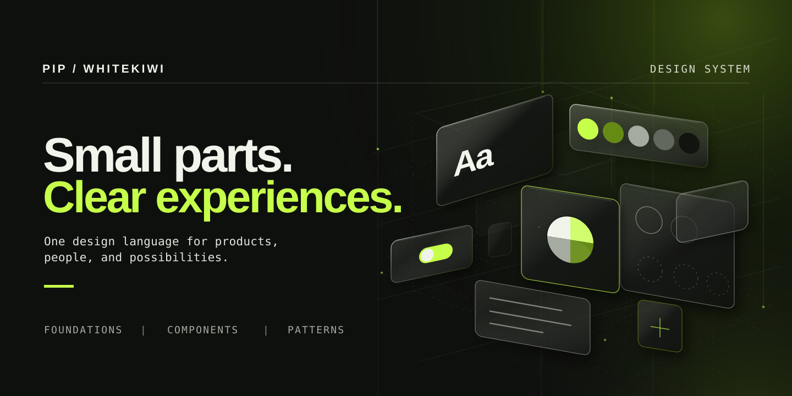

<p align="center">
  
</p>

<p align="center">
  <strong>작은 조각, 명확한 경험.</strong><br>
  WhiteKiwi의 제품을 하나의 시각 언어로 연결하는 디자인 시스템, PIP.
</p>

<p align="center">
  <a href="https://design.whitekiwi.link/">카탈로그</a> ·
  <a href="DESIGN.md">설계 원칙</a> ·
  <a href="docs/README.md">문서 안내</a> ·
  <a href="CONTRIBUTING.md">기여하기</a>
</p>

---

## 미션

명확한 기준과 재사용 가능한 구성요소로 만드는 사람의 반복을 줄이고, 쓰는 사람에게 일관되고 이해하기 쉬운 경험을 제공합니다.

PIP은 색과 간격부터 컴포넌트의 상태와 움직임까지 함께 정의합니다. 흰 여백과 검은 타이포그래피로 콘텐츠를 드러내고, kiwi green으로 중요한 행동을 강조합니다.

## 필요한 만큼 사용하세요

| 구성 | 사용할 때 |
| --- | --- |
| **[@whitekiwi/tokens](packages/tokens/README.md)** | 프레임워크에 관계없이 CSS 토큰과 light·dark 테마를 적용합니다. |
| **[@whitekiwi/ui](packages/ui/README.md)** | React에서 컨트롤, 피드백, 콘텐츠 표면과 펼치기·접기를 조합합니다. |
| **[카탈로그](https://design.whitekiwi.link/)** | 실제 컴포넌트와 상태별 예제, 색의 역할을 살펴봅니다. |

토큰은 단독으로 사용할 수 있습니다. React UI를 사용할 때는 두 패키지의 버전을 맞춥니다.

## 첫 화면 만들기

React 19 이상의 앱에 설치합니다. 현재 검증 기준은 React 19입니다.

```sh
npm install @whitekiwi/ui @whitekiwi/tokens
```

앱의 전역 CSS 진입점에서 토큰, UI 순서로 스타일을 불러옵니다.

```tsx
import "@whitekiwi/tokens/theme.css";
import "@whitekiwi/ui/styles.css";
```

```tsx
import { StaticCard, TextLink } from "@whitekiwi/ui";

export function Welcome() {
  return (
    <StaticCard tone="neutral" padding="spacious">
      <p>아이디어를 새 프로젝트로 이어가세요.</p>
      <TextLink href="/projects/new">프로젝트 만들기</TextLink>
    </StaticCard>
  );
}
```

`/projects/new` 경로와 페이지 레이아웃은 앱에서 구현합니다. 테마 설정은 [토큰 사용법](packages/tokens/README.md#light-dark-or-the-system), 전체 API와 React 서버 렌더링 조건은 [UI 사용법](packages/ui/README.md)에서 확인하세요.

## 함께 지키는 기준

- **반복을 줄입니다.** 기존 토큰과 컴포넌트를 조합하고, 공통으로 필요한 개선을 시스템에 반영합니다.
- **이해와 행동을 명확하게 합니다.** 콘텐츠의 우선순위, 누를 수 있는 표면, 포커스와 상태를 드러냅니다.
- **같은 의미를 유지합니다.** 제품·테마·화면 크기가 달라도 같은 역할과 행동을 일관되게 전달합니다.

선택의 이유와 시스템 구조는 [설계 원칙](DESIGN.md), 색 대비·상태·반응형 요구사항은 [가이드라인](docs/guidelines.md)에 정리되어 있습니다. 실제 제품의 조합과 사용자 정의 스타일은 해당 제품에서 검증합니다.

## 쓰면서 함께 다듬습니다

제품에서 발견한 불편, 빠진 상태, 유용한 조합을 PIP의 개선으로 연결합니다. 하나의 실제 사용 사례로도 제안할 수 있습니다. 컴포넌트와 예제, 검증, 설계 기준이 함께 쌓이고 다음 제품 작업에 다시 쓰이도록 합니다.

[개선 제안](https://github.com/WhiteKiwi/kiwi-design-system/issues/new?template=improvement.yml) · [기여 흐름](CONTRIBUTING.md#사용에서-개선으로)

## 더 알아보기

| 하고 싶은 일 | 시작점 |
| --- | --- |
| 코드를 실행하고 개선하기 | [기여 안내](CONTRIBUTING.md) |
| 구조와 작업별 기준 파일 찾기 | [문서 안내](docs/README.md) |
| 설계의 참고 근거 살펴보기 | [Reference base](references/README.md) |
| 패키지 릴리스 준비하기 | [릴리스 안내](docs/npm-release.md) |

---

[MIT](LICENSE) · WhiteKiwi. 외부 의존성과 별도 라이선스의 자산은 각자의 라이선스를 유지합니다.
