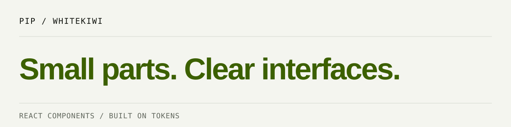

# @whitekiwi/ui

**Quiet structure. Clear interaction.**

PIP's React building blocks: controls, feedback, editorial surfaces, and disclosure.
Semantic HTML carries the structure; `@whitekiwi/tokens` carries the visual language.

[Explore components](https://design.whitekiwi.link/#components) · [Source](https://github.com/WhiteKiwi/kiwi-design-system/tree/main/packages/ui) · [Release guide](https://github.com/WhiteKiwi/kiwi-design-system/blob/main/docs/npm-release.md)

## Two packages, one system

| Package | Responsibility |
| --- | --- |
| [@whitekiwi/tokens](https://github.com/WhiteKiwi/kiwi-design-system/tree/main/packages/tokens) | Framework-independent CSS values and light/dark themes |
| **@whitekiwi/ui** | React components, component CSS, and interaction states |

Tokens can stand alone. UI requires tokens as a peer dependency; install matching
PIP versions. React and React DOM are peers, so your application owns their runtime.

## Build your first screen

Install the packages into your React application:

```sh
npm install @whitekiwi/ui @whitekiwi/tokens react react-dom
```

React and React DOM **19 or newer** satisfy the peer range. Validation currently
uses React 19; newer major versions still need your application-level checks.
The package is ESM-only and includes TypeScript declarations.

Load global CSS once, tokens first, UI second, then your application overrides:

```tsx
// Your application entry point (or framework's global CSS entry).
import "@whitekiwi/tokens/theme.css";
import "@whitekiwi/ui/styles.css";
import "./app.css";
```

```tsx
import { Button, Disclosure, StaticCard, TextField } from "@whitekiwi/ui";

export function ProfileForm() {
  return (
    <StaticCard tone="neutral" padding="spacious">
      <form action="/profile" method="post">
        <TextField
          label="Display name"
          name="displayName"
          autoComplete="nickname"
          hint="The name people will see."
          required
        />
        <Disclosure label="How is this used?">
          <p>Your display name appears on your profile.</p>
        </Disclosure>
        <Button type="submit">Save profile</Button>
      </form>
    </StaticCard>
  );
}
```

The form action is illustrative: provide your own `/profile` handler. The package
does not store data or implement form submission. Use your CSS for page layout
and spacing between components. Load fonts separately; system fallbacks work too.

## Pick the right building block

| Job | Exports | Important behavior |
| --- | --- | --- |
| Actions and navigation | `Button`, `TextLink` | Button defaults to `type="button"`; set `submit` explicitly for forms |
| Labeled input | `TextField`, `Select` | Required `label`; optional `hint` / `error`; generated ID and linked description |
| Single selection | `SegmentedControl` | Native radio group; supports form submission/reset and disabled choices |
| Screen theme | `ThemeControl` | 44×44 icon button. Stores only `light` or `dark` |
| Empty content | `EmptyState` | Title, optional description/actions; no automatic live announcement |
| Status and guidance | `Badge`, `Callout` | Visual tone is not an automatic live announcement |
| Content surfaces | `StaticCard`, `LinkedCard` | Article versus anchor; LinkedCard stacks children in `.kiwi-card-link__body` like StaticCard, with its arrow at the bottom. Use an `href` and avoid nested controls |
| Editorial structure | `SectionHeading`, `CollectionHeading` | SectionHeading renders an `h2`; keep the surrounding heading hierarchy logical |
| Progressive disclosure | `Disclosure` | Radix-backed trigger/content; `defaultOpen` sets initial state |
| Class composition | `cn` | Combines conditional classes and Tailwind class merging |

`Button` supports primary, secondary, ghost, and danger variants, with normal or
compact sizing. Cards support neutral, raised, brand, and inverse tones, with
compact, normal, or spacious padding. `TextField` forwards native input props;
its `className` styles the wrapper, not the input. An `error` takes precedence over
`hint` and marks the input invalid, but does not perform validation for you.

## Selection and empty results

`Select` forwards native select props, including `value`, `defaultValue`, `onChange`,
`required`, `multiple`, `name`, `form`, and React 19 `ref`. Supply native `option` /
`optgroup` children. Its wrapper `className`, label, generated ID, `hint`, `error`,
and external `aria-describedby` follow TextField. The native picker owns keyboard
and mobile interaction; this is not a searchable combobox.

```tsx
<Select label="Billing cycle" name="cycle" defaultValue="monthly" hint="Choose a period.">
  <option value="monthly">Monthly</option>
  <option value="yearly">Yearly</option>
</Select>
```

`SegmentedControl` takes a required `label` and `options` (`value`, `label`, optional
`disabled`). Use `value` with `onValueChange` for controlled state, or `defaultValue`
for native uncontrolled selection. Give choices unique values. `name` is generated
when omitted, keeping separate groups independent. An explicit `name` controls
form submission; `form` associates each radio with an external form. `required`
and group/option `disabled` preserve native validation and submission behavior.
`hideLabel` visually hides the legend without removing the accessible name.

```tsx
<SegmentedControl label="Period" name="period" defaultValue="month"
  options={[{ value: "month", label: "This month" }, { value: "year", label: "This year" }]} />
<EmptyState title="No matching records" description="Try a wider date range.">
  <Button onClick={clearFilters}>Clear filters</Button>
</EmptyState>
```

Import these exports and provide the app's `clearFilters` handler in a client
module. Radio keys and form reset work natively in uncontrolled mode. A controlled
form owns resetting its React state. Do not use this component for navigation or
ARIA tabs. EmptyState renders an `h3`, description and optional action area;
place it under an appropriate heading. The app distinguishes empty, unknown,
loading, and failed results and owns live announcements.

Non-React consumers can load only the stylesheet and use the documented
[native patterns](../../docs/native-patterns.md), with no React browser runtime.

## Screen theme

`ThemeControl` is icon-only: one ghost button, a 44×44 hit
target and a 16px sun/moon reflecting the resolved page theme. The glyph uses
`--kiwi-color-text`; hover/active use control state tokens. Its Korean accessible
name and title describe the action: `어둡게 전환` in light, `밝게 전환` in dark.
Clicking fixes the opposite of the shown theme. There is no reset UI or
`aria-pressed`. Without a stored choice, system changes update the glyph and
`theme-color` live. Focus uses the focus token with a 0.2rem offset.

ThemeControl's `variant="segmented"` was removed in 0.2.5. The `variant`,
`label`, and `hideLabel` props are removed; the control accepts button attributes
instead of fieldset attributes. Native `disabled` disables the button.
`SegmentedControl` is unchanged. Use `commitThemePreference(key, "auto")` for
programmatic reset to the system preference.

The glyph and picked motion A port the official GUI Challenges / Adam Argyle
[theme-switch](https://github.com/argyleink/gui-challenges/tree/82317d0d04c4f38ddf781439e282aa67ecb5b7f6/theme-switch),
commit `82317d0d04c4f38ddf781439e282aa67ecb5b7f6`: original 24×24 sun, eight thin
round-capped rays (2-unit lines, 2px stroke) and crescent mask, displayed at 16px.
Light rays keep their original scale; only the whole SVG is sized to 16px. The original motion uses 250ms sun /
150ms rays / 500ms mask after 250ms delay to dark; to light, 500ms elastic sun
and rays with a 250ms mask. Easing values are inlined without Open Props.
Transitions start only after initial sync has painted; first paint and hydration
stay instant, as does reduced motion. Shared motion tokens are unchanged.
Upstream repository LICENSE is Apache-2.0; theme-switch/package.json declares ISC
(inconsistent metadata). See [third-party notice](THIRD_PARTY.md) and the included
[Apache-2.0 text](LICENSE-APACHE-2.0). WhiteKiwi's package remains MIT.

`light` and `dark` set `<html data-theme="light">` or `data-theme="dark"`.
`auto` removes the attribute so the page follows `prefers-color-scheme`. The
control never writes `data-theme="auto"`. Pass the app's `storageKey`. Only
`light` and `dark` are written; `auto` deletes that key. A stored value other
than those two is removed and treated as `auto`.

Put `pip-theme-bootstrap` in the document head, before CSS, so the first paint
matches the saved choice. It also sets `theme-color` to `#0e0e0e` when the
resolved canvas is dark and `#f4f5ef` when it is light — the same values as
`--kiwi-carbon` and `--kiwi-paper`. Import it from `@whitekiwi/ui/theme` in a
Server Component. That entry has no React dependency and no client directive.
Non-React pages copy the same markup, bootstrap, and a small helper from the
[native patterns](../../docs/native-patterns.md#screen-theme).

```tsx
import { pipThemeBootstrap } from "@whitekiwi/ui/theme";

export function RootLayout({ children }: { children: React.ReactNode }) {
  return (
    <html lang="ko" suppressHydrationWarning>
      <head>
        <meta name="theme-color" content="#f4f5ef" />
        <script
          id="pip-theme-bootstrap"
          dangerouslySetInnerHTML={{ __html: pipThemeBootstrap("app-theme") }}
        />
      </head>
      <body>{children}</body>
    </html>
  );
}
```

```tsx
import { ThemeControl } from "@whitekiwi/ui";

export function AppHeader() {
  return <ThemeControl storageKey="app-theme" />;
}
```

`commitThemePreference(storageKey, preference)` updates the effective in-memory preference first, then best-effort storage, the attribute,
and `theme-color` from an imperative caller. `bindThemeControl(storageKey)`
does the same for native icon buttons. Its optional second argument scopes the
binding to a container or the icon button itself, including initial/storage sync
and motion readiness. Call the returned cleanup to remove listeners and motion
readiness. Omitting the scope binds to `document`.
`themeControlMarkup({ id, theme })`
accepts an optional stable SVG ID prefix and resolved `"light" | "dark"` theme
for static previews or server output. IDs are sanitized to letters, digits,
underscores, and hyphens; provide a distinct prefix per control after sanitizing.
Without options it emits the light icon with a generated unique ID;
binding synchronizes it with the page theme. Call
`commitThemePreference(storageKey, "auto")` to clear the key and return to the
system preference without an icon reset UI. Storage failures (including unavailable
localStorage) retain the effective choice for toggling and labels. Readable
cross-tab storage events refresh cached keys even after the last control unmounts,
including storage clear events. Only subscribed keys apply DOM changes or notify
controls. Media changes follow only an effective `auto`.

## Themes and server rendering

Set `data-theme="light"` or `data-theme="dark"` on `<html>`. For auto, remove
the attribute entirely. The [token package](https://github.com/WhiteKiwi/kiwi-design-system/tree/main/packages/tokens)
describes theme setup and semantic overrides.

The JavaScript entry preserves `"use client"` for React Server Component-aware
frameworks, including the `cn` helper. Call `cn` only from a client module in those
frameworks. Components can be server-rendered as client components, then hydrated;
they are not a server-only component API. Keep event handlers in your app's client
components, and import global CSS in the location supported by your framework.
Keep the server and client tree consistent for React's generated field IDs.

## Public surface and limits

- `@whitekiwi/ui`: components, `cn`, and the named types `ButtonProps`,
  `TextFieldProps`, `SelectProps`, `SegmentedControlProps`, `SegmentedControlOption`,
  `ThemeControlProps`, `ThemePreference`, `EmptyStateProps`, `BadgeProps`, and
  `CalloutProps`
- `@whitekiwi/ui/theme`: `pipThemeBootstrap`, `pipThemeControlScript`,
  `themeControlMarkup`, `bindThemeControl`, and `commitThemePreference`, without
  React or a client directive
- `@whitekiwi/ui/styles.css`: component styles, imported separately
- `@whitekiwi/tokens/theme.css`: required token stylesheet from its own package
- No CommonJS build, global reset, router, or font download. Theme storage uses
  the key the app passes to `ThemeControl` or the bootstrap.

Native semantics, focus styles, reduced-motion rules, and defined contrast pairs
are part of the implementation. They do not certify an entire application.
Provide meaningful labels and links; verify keyboard flow, announcements, custom
styles, and mobile layout in the actual product. Do not use color alone for status.

## Improve PIP through use

Found a missing state, useful composition, or interaction problem? Bring the real
use case back to [PIP](https://github.com/WhiteKiwi/kiwi-design-system/issues/new?template=improvement.yml).
One product example is enough. The [contribution guide](https://github.com/WhiteKiwi/kiwi-design-system/blob/main/CONTRIBUTING.md)
explains how to turn it into a focused issue or PR and verify it in your product.

## License

[MIT](https://github.com/WhiteKiwi/kiwi-design-system/blob/main/packages/ui/LICENSE), copyright WhiteKiwi.
Third-party dependencies retain their own licenses.
